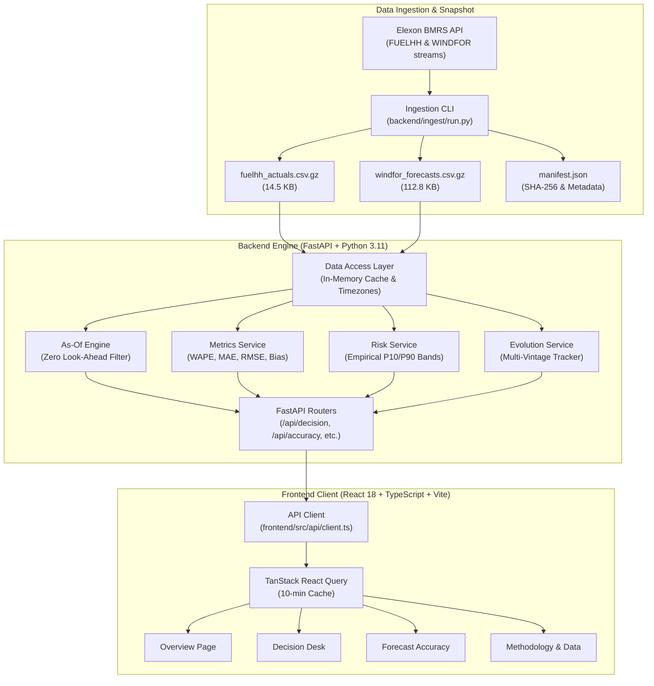

# System Architecture & Technical Design

*Document Version: 1.0.0*

---

## 1. High-Level Architecture Overview

The portal is built as a production-grade, full-stack decision-support system designed to operate both locally via containerization and in serverless cloud environments (Vercel).

---

## 2. Layered Responsibilities

### Layer 1: Ingestion & Snapshot (`backend/ingest/` & `backend/data/`)
- **Ingestion CLI**: Autonomous script with exponential backoff retries, connection pooling, and payload validation.
- **Data Snapshot**:
  - `fuelhh_actuals.csv.gz`: Outturn half-hourly wind generation (1,872 records, 14.5 KB).
  - `windfor_forecasts.csv.gz`: Multi-vintage wind forecasts (22,776 records, 112.8 KB).
  - `manifest.json`: Verification manifest containing endpoints, fetch timestamps, row counts, and cryptographic SHA-256 hashes.
- **Why Gzipped CSV**: Avoids heavy binary dependencies like `pyarrow` in serverless bundles, loads into memory in <25ms, and stays well under Vercel's 500 MB cold-start budget.

### Layer 2: In-Memory Data Access (`backend/app/data_access.py`)
- Lazy-loads snapshots on first invocation and maintains in-memory references.
- Handles time zone conversion via Python's native `zoneinfo` (`Europe/London` and `UTC`), transparently handling winter GMT and summer BST.

### Layer 3: Pure Services (`backend/app/services/`)
- Pure, side-effect-free functions separated from HTTP handling:
  - `asof.py`: Filters forecast vintages with $\text{publishTime} \le \text{cutoff}$, prevents look-ahead, and maps hourly forecasts to 48 settlement periods.
  - `metrics.py`: Computes all headline error metrics (MAE, RMSE, bias, WAPE, guarded MAPE, P50/P90/P95, largest excursions) and generates plain-English trading insights.
  - `risk.py`: Computes empirical hourly error quantiles and derives risk-adjusted wind profiles with daily procurement buffers.
  - `evolution.py`: Assembles all historical forecast vintages predicting a specific target half-hour from 72h out to real-time.

### Layer 4: HTTP Routers & API (`backend/app/routers/` & `main.py`)
- Standardized RESTful endpoints mounted under `/api`.
- Request validation with Pydantic v2 models and informative 4xx errors.
- Automatic interactive documentation at `/api/docs` (Swagger UI).

### Layer 5: Modern Frontend (`frontend/src/`)
- **React 18 + TypeScript (strict)**: Full type safety matching backend Pydantic schemas.
- **Tailwind CSS**: High-density executive dark theme (`#090d16` background, cyan accents, amber forecasts, emerald actuals, indigo risk bands).
- **Recharts**: Responsive SVG charts with custom tooltips, units, and interactive reference lines.
- **TanStack Query**: Client-side caching and background state management.
- **URL Synchronization**: All view parameters (`delivery_date`, `cutoff`, `from`, `to`) stay synced in URL search params for instant sharing and bookmarking.

---

## 3. Key Technical Decisions & Trade-Offs

| Decision | Alternative Considered | Rationale |
| :--- | :--- | :--- |
| **Bundled Snapshot over Live Fetching** | Live calls on every user request | January 2026 data is immutable. Live external API calls introduce latency, vulnerability to Elexon downtime, and potential rate limits during demos. |
| **Gzip CSV over Parquet / SQLite** | Parquet or SQLite database | Parquet requires `pyarrow` (~80 MB wheel). Gzip CSV loads in <25ms using standard pandas and keeps total bundle size under 130 KB. |
| **Vercel Serverless Function** | Standalone EC2 or Heroku Dyno | Zero idle cost, instant global CDN delivery, no cold sleeping delays, and zero container management overhead. |
| **Dual Docker Containers for Local Dev** | Single monolithic container | Clean separation of concerns: Vite/Nginx frontend on port 3000 proxies to FastAPI backend on port 8000, mirroring production topology. |

---

## 4. Extension Points & Future Enhancements

1. **Live Streaming Mode**: Adding a live poller that subscribes to Elexon's live stream with $\text{cutoff} = \text{now()}$ for real-time operations.
2. **Multi-Fuel Integration**: Adding solar PV outturn (`B1630`) and national demand (`ND`) to compute total residual thermal procurement requirements.
3. **Price & Balancing Cost Model**: Multiplying half-hourly MW forecast errors by outturn System Buy Prices (SBP) and System Sell Prices (SSP) to report true cash-flow imbalance costs (£).
4. **Zonal/Regional Decomposition**: Incorporating transmission boundary flow limits (e.g. B6 Anglo-Scottish boundary) to assess transmission constraint wind curtailment risk.
